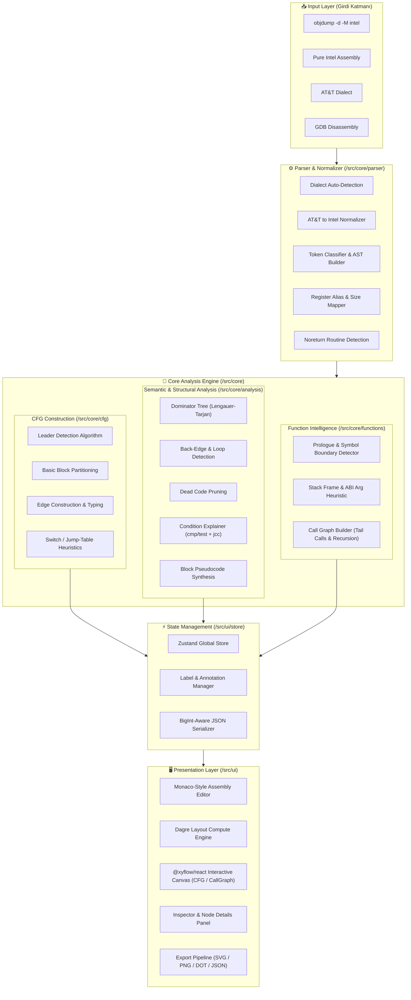
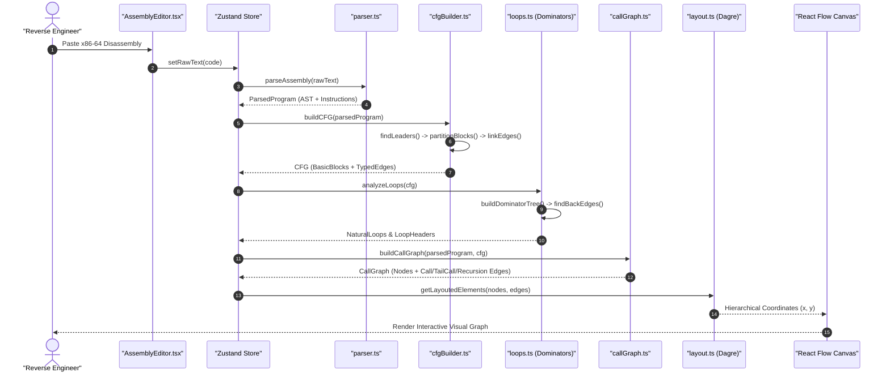

<div align="center">

# ⚡ CodeRebuild (CoreBuild)

### *Advanced In-Browser x86-64 Reverse Engineering, Control Flow & Call Graph Visualizer*

> **"Derlenmiş kodun assembly'sinden okunabilir mantık çıkar."**  
> *Extract human-readable logic, control flow, and architectural call graphs directly from raw compiled x86-64 assembly — 100% client-side, zero-telemetry, and lightning fast.*

<br/>

[](https://www.typescriptlang.org/)
[](https://react.dev/)
[](https://vitejs.dev/)
[](https://tailwindcss.com/)
[](https://reactflow.dev/)
[](https://vitest.dev/)
[](./LICENSE)
[](https://github.com)

<br/>

[✨ Özellikler](#-temel-özellikler--key-features) • [🏛️ Mimari Şema](#️-sistem-mimarisi--architecture-diagrams) • [🚀 Hızlı Başlangıç](#-hızlı-başlangıç--quick-start) • [📐 Algoritmalar](#-derinlemesine-analiz-motoru--algorithms) • [📁 Dizin Yapısı](#-proje-dizin-yapısı--directory-structure) • [🧪 Testler](#-testler--kalite-güvencesi)

</div>

---

## 📖 Genel Bakış / Overview

**CodeRebuild (CoreBuild)**, derlenmiş binary çıktılarından (`objdump`, GDB, AT&T veya saf Intel sözdizimi) elde edilen ham x86-64 assembly kodunu web tarayıcısında gerçek zamanlı olarak analiz eden, **Kontrol Akış Grafiği (CFG)**, **Fonksiyon Çağrı Grafiği (Call Graph)**, **Doğal Döngüler (Natural Loops)** ve **Koşul Açıklamalarını** görselleştiren modern bir tersine mühendislik çalışma ortamıdır.

IDA Pro, Ghidra ve Binary Ninja gibi masaüstü tersine mühendislik araçlarının analitik gücünü, modern web teknolojilerinin hızı ve erişilebilirliği ile buluşturur.

```
 [ Raw Assembly ] ──> [ Multi-Dialect Parser ] ──> [ CFG & Loop Engine ] ──> [ Interactive Canvas ]
 (objdump/GDB/AT&T)   (Normalization & AST)       (Dominators & Blocks)       (React Flow + Dagre)
```

---

## ✨ Temel Özellikler / Key Features

- **🌐 Çoklu Sözdizimi Desteği (Multi-Syntax Ingestion):**
  - GNU `objdump -d -M intel` formatı (adres, makine kodları, semboller)
  - Saf Intel sözdizimi (`mov eax, 1`, `DWORD PTR [rbp-4]`)
  - AT&T sözdizimi (`movl $1, %eax`, `%rbp` kaynak/hedef otomatik normalizasyonu)
  - GDB `disassemble` çıktıları (`=> 0x0000000000401129 <+0>: ...`)
  - Bilinmeyen/bozuk satırlar `UnknownInstruction` olarak işaretlenir, analiz akışı asla çökmez.

- **📊 Etkileşimli Kontrol Akış Grafiği (CFG):**
  - **Leader Algoritması** ile kusursuz Basic Block bölümlemesi.
  - **Dagre** destekli dinamik hiyerarşik yerleşim.
  - Tersine mühendislik standartlarında renk kodlamalı kenarlar (Taken, Not-Taken, Unconditional, Call, Return).
  - Giriş, çıkış, ölü kod (Dead Code) ve döngü bloklarının özel rozetlerle vurgulanması.

- **🔄 Dominator Ağacı & Doğal Döngü Tespiti (Natural Loops):**
  - CFG üzerindeki geri kenarlar (*back-edges*) tespit edilerek doğal döngüler ve döngü başlıkları (*loop headers*) otomatik çıkarılır.
  - Döngü derinlikleri ve döngü gövdeleri renklendirilir.

- **📞 Fonksiyon Sınırları & Çağrı Grafiği (Call Graph):**
  - Prologue tespiti (`push rbp; mov rbp, rsp`), sembol etiketleri (`<func>:`) ve `ret` hizalamasıyla fonksiyon tespiti.
  - Fonksiyonlar arası `call`, kuyruk çağrısı (*tail call*) ve özyineleme (*recursion*) analizi.
  - System V AMD64 ABI argüman register (`rdi`, `rsi`, `rdx`, `rcx`, `r8`, `r9`) aday tespiti ve stack frame boyutu (`sub rsp, N`).
  - Akışı kesen (*noreturn*) fonksiyonların (`exit`, `abort`, `__stack_chk_fail`, `ud2`) tanınması.

- **🧠 İnsan-Okur Koşul & Sözde Kod Üretimi (Condition Explanation):**
  - `cmp`/`test` ile koşullu atlamaları (`jg`, `jle`, `je`, `jne`, `ja`, `jb` vb.) eşleştirerek anlaşılır açıklamalar üretir.
  - Örnek: `eğer eax <= 5 ise L2 etiketine atla (signed)`.

- **⚡ Çift Yönlü Senkronize Seçim (Bidirectional Highlighting):**
  - Assembly editöründe satıra tıklandığında CFG'deki ilgili bloğa yumuşak geçişle odaklanılır (`fitBounds` / `setCenter`).
  - CFG bloğu seçildiğinde editörde ilgili satırlar anında vurgulanır ve kaydırılır.

- **🏷️ Etiketleme & Yeniden Adlandırma (Interactive Annotations):**
  - Fonksiyon, blok veya hafıza adreslerini anında yeniden adlandırma (Klavye Kısayolu: `L`).
  - Tüm CFG bloklarında, çağrı grafiğinde ve koşul metinlerinde otomatik sembol ikamesi (`call 0x401136` ➔ `call parse_input`).

- **🔢 64-bit Adresleme Doğruluğu (BigInt Architecture):**
  - JavaScript'in 53-bit `Number` sınırı aşılmış; tüm sanal adresler tam 64-bit `bigint` ile yönetilir.
  - Özel BigInt JSON serileştirici ile veri kaybı yaşanmaz.

- **🛡️ Sıfır Telemetri & %100 İstemci Taraflı (Zero-Telemetry / Offline):**
  - Hiçbir veri, kaynak kodu veya analiz sunucuya gönderilmez. Tamamen tarayıcınızda çalışır.

- **💾 Zengin Dışa Aktarma (Rich Export):**
  - SVG ve PNG yüksek çözünürlüklü grafik dışa aktarma.
  - Graphviz DOT formatı (`.dot`).
  - SHA-256 bütünlük doğrulamalı JSON oturum dışa/içe aktarma.

---

## 🏛️ Sistem Mimarisi / Architecture Diagrams

CodeRebuild, sorumlulukların net olarak ayrıldığı (*Clean Architecture*) katmanlı bir yapı üzerine inşa edilmiştir.

### 1. Üst Seviye Sistem Mimarisi (High-Level Architecture)



---

### 2. Analiz Akışı ve Veri Hattı (Data Pipeline Flow)



---

### 3. Kenar Renk Kodlama Tablosu (Edge Color Coding Schema)

CFG ve Çağrı Grafiğinde kullanılan renk standartları endüstri standardı tersine mühendislik araçlarıyla uyumludur:

| Kenar Türü | Renk | Hex Kodu | Açıklama |
|---|---|---|---|
| **Branch Taken (True)** | 🟢 Canlı Yeşil | `#10b981` | Koşullu atlama koşulunun sağlandığı durum (`jz`, `jnz`, vb.) |
| **Branch Not Taken (False)** | 🔴 Mercan Kırmızı | `#ef4444` | Koşulun sağlanmayıp sonraki komuta akıldığı durum |
| **Unconditional Jump** | 🔵 Canlı Mavi | `#3b82f6` | Şartsız atlama (`jmp`) |
| **Function Call** | 🟣 Mor (Kesikli) | `#a855f7` | Fonksiyon alt program çağrıları (`call`) |
| **Tail Call** | 🟠 Kehribar Turuncu | `#f59e0b` | Başka fonksiyona doğrudan kuyruk atlaması (`jmp <other_func>`) |
| **Fallthrough / Return** | ⚪ Nötr Gri | `#71717a` | Düz düşme veya fonksiyondan dönüş (`ret`) |

---

## 🚀 Hızlı Başlangıç / Quick Start

### Gereksinimler (Prerequisites)
- [Node.js](https://nodejs.org/) v18.0.0 veya üzeri
- `npm` (veya `pnpm` / `yarn`)

### Kurulum (Installation)

```bash
# Projeyi klonlayın
git clone https://github.com/weakness09/corebuild.git

# Proje dizinine girin
cd corebuild

# Bağımlılıkları yükleyin
npm install
```

### Geliştirme Sunucusu (Development Server)

```bash
npm run dev
```
Uygulama varsayılan olarak `http://localhost:5173` adresinde başlatılır.

### Üretim Derlemesi (Production Build)

```bash
npm run build
```
Optimize edilmiş statik dosyalar `/dist` dizinine derlenir. Herhangi bir web sunucusunda (Nginx, Vercel, Netlify, GitHub Pages) statik olarak barındırılabilir.

---

## 🧪 Testler / Kalite Güvencesi

Proje, analiz doğruluğu ve gerileme önleme için kapsamlı bir Vitest test paketine sahiptir.

```bash
# Tüm birim ve entegrasyon testlerini çalıştırın
npm test

# Test kapsamı (coverage) raporu üretin
npm run test:coverage

# TypeScript tip denetimi (strict typecheck)
npm run lint
```

### Test Paketi Özeti:
- ✅ **Parser Testleri:** Düz Intel, objdump, AT&T operand sırası, GDB sözdizimi, bozuk/hatalı satırlar
- ✅ **CFG Testleri:** Leader saptama, kenar ilişkilendirme, switch jump-table sezgiseli
- ✅ **Fonksiyon Testleri:** Prologue tespiti, stack frame boyutlandırma, özyineleme (fact/fib), noreturn tespiti
- ✅ **Döngü Testleri:** Dominator analizi, geri kenarlar, iç içe döngüler
- ✅ **Etiketleme Testleri:** İsim çakışması kontrolü, sembol ikamesi, serialization
- ✅ **Stres Testi:** 5.000+ komutluk assembly girdilerinin 1 saniyenin altında analiz edilmesi

---

## 📐 Derinlemesine Analiz Motoru / Algorithms

### 1. Leader Algoritması ile Temel Blok Çıkarma
Temel bloklar (*Basic Blocks*), tek giriş ve tek çıkış kuralına uyan komut dizileridir. Lider komutlar aşağıdaki kurallarla saptanır:
1. Programın veya fonksiyonun ilk komutu liderdir.
2. Herhangi bir koşullu veya koşulsuz atlama/çağrı hedefi olan komut liderdir.
3. Herhangi bir atlama (`jmp`, `jcc`) veya dönüş (`ret`) komutunun hemen ardındaki komut liderdir.
4. Tanımlanmış sembolik etiketlerin (`.L1:`, `<main>:`) başladığı noktalar liderdir.

### 2. Dominator Ağacı ve Geri Kenar Analizi (Natural Loops)
Doğal döngüleri tespit etmek için iterative dominatör analizi uygulanır:
- Bir $D$ düğümü, girişten $N$ düğümüne giden her yolda yer alıyorsa "$D$ dominates $N$" ($D \text{ dom } N$) denir.
- Bir $B \to A$ kenarı varsa ve $A \text{ dom } B$ şartı sağlanıyorsa, bu kenar bir **Geri Kenar** (*Back-Edge*) olarak nitelendirilir.
- $A$ düğümü döngü başlığı (*loop header*), $B$ düğümü ise döngü mandalı (*loop latch*) olur.
- Döngü gövdesi, $A$'ya ulaşabilen ve $A$ tarafından domine edilen tüm blokları içerir.

### 3. 64-bit Adres Uzayı Yönetimi (BigInt Architecture)
Modern x86-64 ikilileri canonical 48-bit veya tam 64-bit sanal bellek adresleri kullanır (`0x7fff_ffff_ffff` veya çekirdek alanında `0xffff_8880_...`). JavaScript varsayılan `Number` tipi $2^{53}-1$ değerinden büyük sayılarda veri kaybına yol açtığından:
- Tüm adresler `bigint` olarak temsil edilir.
- `/src/core/utils/json.ts` içinde geliştirilen özel `BigInt` JSON serileştirici ile veri depolaması ve aktarımı kayıpsız gerçekleştirilir.

---

## 📁 Proje Dizin Yapısı / Directory Structure

```text
corebuild/
├── memory-bank/                # Mimari kararlar, ilerleme ve bağlam belgeleri
│   ├── activeContext.md
│   ├── productContext.md
│   ├── progress.md
│   ├── projectbrief.md
│   ├── systemPatterns.md
│   └── techContext.md
├── src/
│   ├── core/                   # 🧠 Saf, UI'dan bağımsız Tersine Mühendislik Motoru
│   │   ├── analysis/           # Dominatörler, döngüler, ölü kod, koşul yorumlama
│   │   ├── cfg/                # Leader tespiti, BasicBlock ve CFGEdge kurucuları
│   │   ├── export/             # Graphviz DOT ve veri dışa aktarım modülleri
│   │   ├── functions/          # Çağrı grafiği, stack frame ve ABI tespiti
│   │   ├── labels/             # Kullanıcı etiketleme ve sembol ikame yöneticisi
│   │   ├── parser/             # x86-64 Ayrıştırıcı, register haritası, normalizasyon
│   │   └── utils/              # 64-bit BigInt JSON dönüştürücüleri
│   ├── ui/                     # 🖥️ React & React Flow Kullanıcı Arayüzü
│   │   ├── components/
│   │   │   ├── details/        # Seçili blok ve komut denetim paneli
│   │   │   ├── editor/         # Assembly giriş ve sözdizimi vurgulayıcı editör
│   │   │   ├── export/         # SVG, PNG, DOT, JSON indirme menüsü
│   │   │   ├── graph/          # React Flow düğümleri, kenarları ve Dagre yerleşimi
│   │   │   └── layout/         # 3 bölmeli duyarlı ana yerleşim ve araç çubuğu
│   │   └── store/              # Zustand global durum yönetimi
│   ├── App.tsx                 # Ana React uygulama sarmalayıcısı
│   ├── index.css               # Tailwind CSS & özel scrollbar stilleri
│   └── main.tsx                # React DOM giriş noktası
├── tests/                      # 🧪 Vitest Test Paketi & Fixture Dosyaları
│   ├── analysis/               # Döngü ve dominatör birim testleri
│   ├── cfg/                    # CFG oluşturma testleri
│   ├── fixtures/               # Gerçek dünya assembly örnekleri (.asm)
│   ├── functions/              # Çağrı grafiği ve çerçeve testleri
│   ├── integration/            # 5000+ komutluk stres testleri
│   ├── labels/                 # Etiket ikame testleri
│   └── parser/                 # objdump, GDB, AT&T ayrıştırma testleri
├── package.json
├── tailwind.config.js
├── tsconfig.json
└── vite.config.ts
```

---

## ⌨️ Klavye Kısayolları / Keyboard Shortcuts

| Kısayol | Eylem |
|---|---|
| `L` | Seçili blok, komut veya adres için hızlı **Etiket Ekle/Düzenle** penceresini açar |
| `Ctrl + +` / `Ctrl + -` | Grafik tuvalinde yakınlaştır / uzaklaştır |
| `Space + Drag` | Tuvali sürükle / kaydır (*Pan*) |
| `Shift + Click` | Çoklu blok seçimi |

---

## 🤝 Katkıda Bulunma / Contributing

Katkılarınızı memnuniyetle kabul ediyoruz!
1. Bu depoyu Fork'layın (`Fork`).
2. Yeni bir özellik dalı oluşturun (`git checkout -b feature/harika-ozellik`).
3. Değişikliklerinizi commit edin (`git commit -m 'feat: Yeni özellik eklendi'`).
4. Dalınızı push edin (`git push origin feature/harika-ozellik`).
5. Bir **Pull Request** açın.

---

## 📜 Lisans / License

Bu proje [MIT Lisansı](./LICENSE) kapsamında lisanslanmıştır. Dilediğiniz gibi kullanabilir, değiştirebilir ve dağıtabilirsiniz.

<div align="center">

Geliştirici: **[@weakness09](https://github.com/weakness09)**  
*CodeRebuild — Bringing binary intelligence to the modern web.*

</div>
