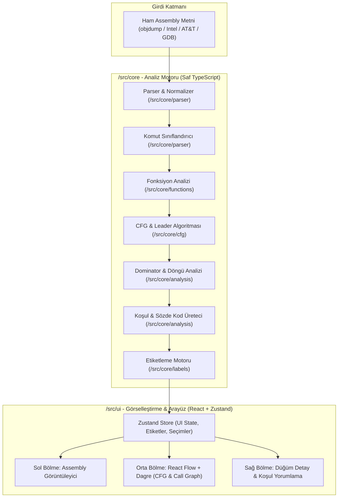

# System Patterns - CodeRebuild

## 1. Mimari Genel Bakış

CodeRebuild iki ana katmandan oluşur:
1. **Çekirdek Analiz Motoru (`/src/core`):** React veya tarayıcı DOM bağımlılığı olmayan, saf TypeScript fonksiyonları ve veri yapıları. CLI veya Node.js ortamlarında da çalışabilecek şekilde tasarlanmıştır.
2. **Kullanıcı Arayüzü Katmanı (`/src/ui`):** Zustand durum yönetimini, React Flow görselleştirme bileşenlerini, Monaco veya benzeri sözdizimi editörünü ve detay panellerini içeren sunum katmanı.

---

## 2. Modül Yapısı ve Sorumluluklar

### 2.1 `/src/core/parser`
- `parser.ts`: Girdi formatını tespit eder (`objdump`, GDB, düz Intel, AT&T). AT&T operand sırasını ve sözdizimini Intel standardına normalize eder.
- `types.ts`: `Instruction`, `Operand`, `InstructionCategory`, `ParsedProgram` arayüzlerini tanımlar.
- `registers.ts`: x86-64 register alias tablosu (ör. `rax`, `eax`, `ax`, `al` -> `RAX` ailesi) ve boyut eşlemeleri.
- `classifier.ts`: Komutları `ARITH`, `LOGIC`, `MOVE`, `STACK`, `COMPARE`, `COND_JUMP`, `UNCOND_JUMP`, `INDIRECT_JUMP`, `CALL`, `INDIRECT_CALL`, `RET`, `SYSCALL`, `NOP`, `OTHER` kategorilerine ayırır.
- `noreturn.ts`: Akışı sonlandıran fonksiyonların (`exit`, `abort`, `__stack_chk_fail`, `__assert_fail`) ve komutların (`ud2`, `hlt`) statik tablosu.

### 2.2 `/src/core/cfg`
- `leader.ts`: Leader komutları tespit eder (ilk komut, atlama hedefleri, atlama/ret ardılı komutlar, fonksiyon girişleri).
- `blockBuilder.ts`: Leader'ları sıralayıp basic block'ları (`BasicBlock`) oluşturur.
- `edgeBuilder.ts`: Bloklar arası kenarları (`CFGEdge`) bağlar: `fallthrough`, `jump_taken`, `jump_not_taken`, `unconditional`, `indirect`.
- `switchResolver.ts`: Jump table kalıplarını sezgisel (`cmp reg, N; ja default; jmp [tbl+reg*8]`) olarak yakalar; çözülemeyenler için `unresolved indirect` blokları oluşturur.

### 2.3 `/src/core/functions`
- `detector.ts`: Fonksiyon girişlerini belirler: (a) sembol başlıkları (`<main>:`), (b) `call` hedefleri, (c) prologlar (`push rbp; mov rbp, rsp`), (d) `ret` sonrası hizalama.
- `callGraph.ts`: Fonksiyonlar arası `CallGraph` grafiğini üretir. `call`, `tail call` (dışarıya `jmp`) ve özyineleme (`recursion`) ilişkilerini saptar.
- `frameAnalysis.ts`: `sub rsp, N` ve yığın manipülasyonundan çerçeve boyutunu ve System V ABI argüman register (`rdi`, `rsi`, `rdx`, `rcx`, `r8`, `r9`) ilk kullanımını yakalar.

### 2.4 `/src/core/analysis`
- `dominators.ts`: Lengauer-Tarjan veya iterative bitvector algoritması ile dominator ağacını kurar.
- `loops.ts`: Geri kenarları ($B \to A$, $A$ dominator of $B$) yakalar, doğal döngüleri (natural loops) ve loop header bloklarını işaretler.
- `deadCode.ts`: Fonksiyon girişinden erişilemeyen blokları (`isDead: true`) olarak işaretler.
- `conditionInterpreter.ts`: `cmp/test` ve ardından gelen koşullu atlamayı eşleştirip insan-okur Türkçe açıklama ve karşılaştırma operatörü üretir.
- `pseudoCode.ts`: Blok başına 1-3 satırlık soyutlanmış sözde kod özeti üretir.

### 2.5 `/src/core/labels`
- `labelManager.ts`: Etiket ekleme, güncelleme, silme, isim çakışması önleme, geçerlilik kontrolü.
- `substitutor.ts`: Metin ve grafik düğümlerinde etiket ikamesi (`call 0x401136` -> `call parse_input`, `[rbp-0x14]` -> `var_14` veya `[counter]`).
- `serializer.ts`: JSON dışa/içe aktarma ve SHA-256 girdi hash doğrulaması.

---

## 3. Veri Akışı ve Tasarım Kararları

1. **İmmutability & Saf Fonksiyonlar:**
   - `/src/core` içindeki tüm fonksiyonlar girdilerini mutasyona uğratmaz, yeni analiz nesneleri döndürür.
   - Bu durum test yazımını kolaylaştırır ve Zustant store entegrasyonunda öngörülebilirliği garanti eder.

2. **Hiyerarşik Grafik Yerleşimi (Dagre Entegrasyonu):**
   - CFG ve Call Graph yerleşiminde Dagre kullanılır.
   - Blok boyutları komut sayısına ve içerik genişliğine göre dinamik hesaplanır.
   - Kenarlar ortogonal veya yumuşak bezier olarak çizilir; yeşil (true/taken) ve kırmızı (false/not taken) renk standartları tersine mühendislik araçlarıyla (IDA/Ghidra/Binary Ninja) uyumludur.

3. **Çift Yönlü Seçim Senkronizasyonu (Bidirectional Highlighting):**
   - Assembly metninde bir satıra tıklandığında ilgili satırın `address` değeri üzerinden ilgili `BasicBlock` bulunur ve React Flow tuvalinde odaklanılır (`fitBounds` / `setCenter`).
   - CFG üzerinde bir bloğa tıklandığında assembly editöründe ilgili satırlar vurgulanır ve görünür alana kaydırılır.

4. **Kullanıcı Veri Gizliliği (Zero-Telemetry / Offline-First):**
   - Hiçbir analiz sonucu veya assembly kodu harici bir sunucuya gönderilmez.
   - Yerel depolama olarak sadece `localStorage` kullanılır.
